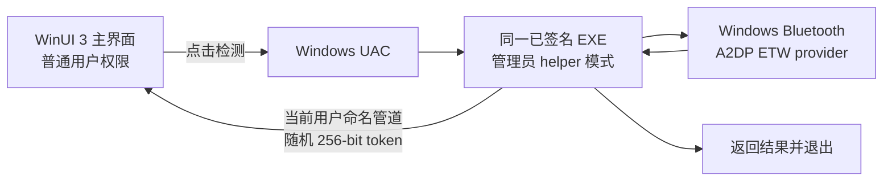

<div align="center">
  

# Bluetooth Audio Codec

**查看 Windows 与蓝牙耳机当前协商使用的 Bluetooth Classic A2DP 编解码器。**

SBC · AAC · aptX · aptX HD · aptX Low Latency · LDAC · LHDC · 更多

Windows 10/11 · WinUI 3 · x64/ARM64
</div>


## 下载安装

### Microsoft Store（推荐）

<a href="https://get.microsoft.com/installer/download/9p8g2cqw77jt?referrer=appbadge" target="_self">
  
</a>

- 商店页面：<https://apps.microsoft.com/detail/9P8G2CQW77JT>
- 支持自动更新，Windows 10（build 19041+）与 Windows 11 的 x64 / ARM64 设备均可安装；
- 也可以用 winget 安装：

```powershell
winget install --source msstore --id 9P8G2CQW77JT
```

### 离线安装包（MSI）

从 [GitHub Releases](https://github.com/A-BenLi06/Bluetooth-Audio-Codec-Viewer-WinUI3/releases)
下载 x64 或 ARM64 的离线 MSI 安装包。安装包包含完整原生程序和 WinUI 依赖，无下载器和捆绑组件，
无需另装 .NET Runtime。

## 简介

Bluetooth Audio Codec 是一款专注、现代的 Windows 桌面工具。它监听 Windows
公开的 Bluetooth A2DP ETW 事件，并显示系统与耳机或音箱当前协商使用的音频
编解码器、默认输出设备及底层 codec ID。

检测完全在本机完成。应用不会录制音频、修改蓝牙设置、安装驱动或后台服务，也不会
上传设备信息。

## 功能

- App 打开期间自动监听蓝牙音频设备的连接与断开，并刷新设备名和默认输出；
- 检测当前 Bluetooth Classic A2DP 编解码器；
- 检测时尝试暂停所有正在播放且支持控制的系统媒体会话（包括其他输出设备），结束或取消后恢复本次暂停的会话；原本暂停的内容不会被启动；
- 识别 SBC、AAC、aptX Classic、aptX HD、aptX Low Latency、FastStream、
  LDAC、Samsung Scalable Codec、LHDC 等已知格式；
- 显示标准 codec ID、vendor ID、vendor codec ID、默认输出设备和检测时间；
- 无法识别的编解码器仍会保留其原始数字标识，便于排查；
- 本地轮转日志，以及统一的 **Report a problem** 入口：选择检测记录或应用上下文、预览并导出诊断 ZIP，可选附加近期脱敏日志；不会自动上传；
- 支持 x64 和 ARM64，无需用户另装 .NET Runtime；离线 MSI 自包含，商店 MSIX 自动安装所需 Windows App Runtime；
- 提供英语、简体中文、繁体中文、日语、法语、西班牙语、葡萄牙语、德语和
  意大利语界面。

## 使用方法

1. 连接蓝牙耳机或音箱，并将其设为当前播放设备。
2. 正常启动应用，无需以管理员身份运行整个界面。
3. 点击 **Detect codec**，在 Windows 弹出提示时批准管理员权限。
4. helper 确认开始监听后，程序尝试暂停所有正在播放且支持暂停的 Windows 系统媒体会话，再在选定输出端点播放短促、安静的测试音。结束或取消后尝试恢复本次暂停的原会话。
   暂停不保证音频流已关闭或驱动会上报 codec；网页、游戏和远程会话等其他音频可能需要手动处理，界面会提示仍活动的音频进程。
5. 检测到事件后，主卡片会显示当前编解码器和输出设备；展开
   **Technical details** 可查看原始标识。

管理员权限仅用于一次检测。检测结束或取消后，短生命周期 helper 会退出。

## 工作原理



Windows 将蓝牙 codec trace 限制给提升权限的进程，因此检测时必须请求 UAC。
主界面始终保持普通权限；helper 使用仅限当前用户的随机命名管道返回结果，不会常驻。

## 支持范围与限制

- 最低系统版本：Windows 10 版本 2004（build 19041）；
- 支持处理器：x64、ARM64；
- 仅检测 Bluetooth Classic 的 A2DP 播放链路；
- 免提通话使用的 HFP（CVSD/mSBC）不属于 A2DP，不会显示；
- Bluetooth LE Audio 使用不同的事件和 codec 路径，目前不检测 LC3；
- 检测结果来自 Windows 建立或关闭串流时发出的事件。如果没有捕获到事件，请暂停
  其他播放后重新检测，或在监听窗口内重新连接同一耳机；原生版不会因为一次连接变化直接取消，但会重新核对当前输出，丢弃不属于目标设备的结果；
- 结束汇总事件只代表最近观测到的串流编码，界面会明确标注；成功配置事件还必须有同一目标的新播放开始事件确认；
- 某些第三方驱动不提供可解析的事件或设备拓扑。应用会报告具体原因，不会根据耳机型号猜测正在使用的编码；
- 厂商驱动和 Windows 版本可能引入新的 ID。未知 ID 会原样显示，但名称可能需要后续
  补充。

## 反馈问题与导出日志

复现问题后，点击窗口下方 **报告问题… / Report a problem…**，选择出错的那次检测，
可勾选“附加近期运行日志”，逐文件检查内容后保存一个 `.zip`。没有检测记录，或要报告启动问题时，
选择“应用／启动问题”；不会伪造一次检测。保存后可显示文件、复制摘要或打开 GitHub。
请在浏览器中登录、附上检查过的 ZIP，再提交问题；应用不会自动上传文件。

**GitHub 问题及附件公开，选择附件时就会立即上传，早于提交问题。**
不要附上原始 ETL、dump 或未过滤的设备记录。导出失败也可以先提交文字。

标准报告包含构建 ID、Windows / 目标驱动版本、检测终态、数字错误、采集统计，以及
当次检测开始和结束/失败时的设备关系。设备使用报告内匿名代号关联，不含原始地址、
PnP / 容器 ID、设备昵称、音频或完整 ETW 负载；不会在导出时用当前状态覆盖故障现场。
新快照还包含可读取的耳机产品型号、厂商及属性来源，缺失值保留为未知，不用昵称或驱动厂商猜测型号。
多台设备分别关联默认输出，身份未解析时标记为未知；连接列表覆盖 Classic 音频/视频设备及已解析的默认蓝牙目标，
不保证列出全部 LE 设备。Windows 属性未经用户确认，可在 GitHub 表单中补充或更正品牌和型号。
附加的 `runtime-log.txt` 是经过过滤的近期运行历史，最多 512 KiB，可能跨越多次检测，并包含
导出时读取的环境／输出状态；它与故障时快照分开标注。分享前需人工检查，不能保证任意日志文本完全匿名。
格式、开发者接收校验和测试说明见 [diagnostics/README.md](diagnostics/README.md)。

结构化记录位于 `%LOCALAPPDATA%\BluetoothAudioCodecViewer\Reports`，保留最多五次失败/
未正常结束及最近一次成功/取消，最长七天，总量不超过 10 MiB；主动导出的文件不随之删除。
构建版本来自编译元数据，MSIX 身份不等于来自 Microsoft Store。

本地日志位于 `%LOCALAPPDATA%\BluetoothAudioCodecViewer\Logs`，约 1 MiB 后轮转，
仅保留 `runtime.log` 和 `runtime.log.previous`。也支持
`BluetoothAudioCodec.WinUI.exe --export-diagnostics "保存路径.txt"`。
旧 TXT 命令保留兼容。界面已统一为“报告问题”，无需分别导出 ZIP 和 TXT。
`BluetoothAudioCodec.WinUI.exe --export-report "保存路径.zip" --include-runtime-log` 可导出同样的组合包；
没有检测记录时生成应用上下文报告。省略 `--include-runtime-log` 则不附加日志。

## 从源码开发

在 VS 2026 中打开 `BluetoothAudioCodec.WinUI/BluetoothAudioCodec.WinUI.slnx`，
选择 **Debug / x64**，以 **本地 Windows 调试器 / F5** 启动。
Debug 已配置为自包含普通 EXE，无需部署或签名 MSIX。
具体步骤和 helper 断点说明见 [VS 2026 测试说明](docs/NATIVE_MIGRATION.md#在-visual-studio-2026-中测试)。

### 环境要求

- Visual Studio 2022/2026，安装 C++ 桌面开发、WinUI C++ 工具及 ARM64 交叉编译工具；
- .NET SDK 仅用于 WiX 安装器构建；CLI 和 UI 均无需 .NET；
- Windows 10 SDK 10.0.26100 或更高版本；
- 生成 Partner Center 上传包时，还需安装 Windows SDK 的 Debugging Tools
  （脚本会检查 `mspdbcmf.exe` 生成的 `.appxsym`）；
- 构建安装包时需要 WiX Toolset SDK 6（项目会通过 NuGet 还原 6.0.2）。

### Visual Studio 入口

用 Visual Studio 打开：

```text
BluetoothAudioCodec.WinUI/BluetoothAudioCodec.WinUI.slnx
```

启动项目是 `BluetoothAudioCodec.WinUI.vcxproj`。选择 `x64` 或 `ARM64` 平台后即可
构建和调试。安装器是独立项目
`BluetoothAudioCodec.Installer/BluetoothAudioCodec.Installer.wixproj`。

GUI 已迁移为 C++20 / C++/WinRT + WinUI 3，保留原有 XAML、九种语言和现代界面。
ETW/TDH、Core Audio COM、测试音、随机数及提权通信均使用 Windows 原生接口。
应用直接引用 Windows App SDK 的 WinUI 组件，避开未使用的 AI/ML 等依赖。
离线 MSI 包含 WinUI 原生运行文件；商店 MSIX 复用 Windows App Runtime。两者均无需 .NET。
体积对比及发布依赖说明见
[APP_SIZE.md](docs/APP_SIZE.md)。

### 命令行构建

```powershell
# 在 Visual Studio Developer PowerShell 中运行
msbuild .\BluetoothAudioCodec.WinUI\BluetoothAudioCodec.WinUI.vcxproj `
    /restore /p:Configuration=Release /p:Platform=x64
```

生成本地测试用 x64 和 ARM64 MSI：

```powershell
.\build-store-installer.ps1 -Architecture all -Version 1.0.0
```

输出位于 `artifacts/native/installer/`；可用 `-OutputDirectory` 指定独立目录。
离线版采用 EXE + WinUI DLL/资源文件的目录布局；分发完整 MSI，或压缩完整发布目录，
不可单独复制 EXE。没有受信任代码签名的构建仅供本地测试，不能上传
Microsoft Store。

### 签名发布构建

```powershell
.\build-store-installer.ps1 `
    -Architecture all `
    -Version 1.0.0 `
    -Manufacturer "BenLi06" `
    -CertificateThumbprint YOUR_CERTIFICATE_THUMBPRINT `
    -RequireSigning
```

脚本会先签名并时间戳主 EXE，再将完整发布目录嵌入 MSI，最后签名 MSI；同时生成包含 SHA-256、
签名状态和静默安装命令的 release manifest。Store 发布前的完整步骤见
[STORE_SUBMISSION.md](docs/STORE_SUBMISSION.md)。

## CLI 与 UI：同一个内核

UI 版的现有原生功能是基线。CLI 与 UI 均编译 `BluetoothAudioCodec.Core` 中的同一份
C++20 源码，共享 ETW 解析、目标核对、提权管道、测试音、媒体暂停与恢复、设备查询和诊断报告。
UI 提供图形交互与九种语言；CLI 提供终端参数、JSON 输出和退出码。

```powershell
./build-cli.ps1
./BluetoothAudioCodec.Cli/bin/x64/Release/BluetoothAudioCodec.Cli.exe --timeout 30 --json
./BluetoothAudioCodec.Cli/bin/x64/Release/BluetoothAudioCodec.Cli.exe --watch --no-tone
./BluetoothAudioCodec.Cli/bin/x64/Release/BluetoothAudioCodec.Cli.exe --export-report report.zip --include-runtime-log
```

CLI 可从普通终端启动，检测时由共享内核按需请求 UAC。`Ctrl+C` 取消检测并恢复本次暂停的媒体。
`--watch` 重复执行完整检测，每次可能请求 UAC；它不是后台连接监听模式。
完整参数及退出码见 [CLI 说明](BluetoothAudioCodec.Cli/README.md)。
旧 C# file-based app 已移入 `archive/legacy-cli/`，仅供历史参考，不作为功能基线。

## 项目结构

| 路径 | 职责 |
| --- | --- |
| `BluetoothAudioCodec.slnx` | CLI、UI 的统一开发入口 |
| `BluetoothAudioCodec.Core/` | 共享原生内核与共同源文件清单，不依赖 WinUI |
| `BluetoothAudioCodec.WinUI/` | UI 入口、XAML、交互、本地化与 MSIX 定义 |
| `BluetoothAudioCodec.Cli/` | CLI 入口、参数解析、终端与 JSON 呈现 |
| `BluetoothAudioCodec.Installer/` | UI 的 WiX MSI 安装器 |
| `tests/` | 共享设备身份、连接状态等原生测试 |
| `diagnostics/` | 诊断契约、接收校验和测试工具 |
| `docs/` | 构建、发布、迁移、审计与历史说明 |
| `StoreAssets/` | 商店图标、截图、文案及宣传材料 |
| `app-website/` | 产品网站（独立前端） |
| `archive/legacy-cli/` | 已归档的旧 C# CLI |
| 根目录 `build-*.ps1` / `test-*.ps1` | 构建、打包与验证入口 |

依赖边界和维护规则见 [架构说明](docs/ARCHITECTURE.md)。构建产物留在被忽略的
`bin/`、`obj/`、`artifacts/` 等目录，不混入源码。

## 隐私与安全

- 所有检测和解析均在设备本地进行；
- 仅在 App 打开期间读取已配对蓝牙音频设备的连接状态和显示名称；
- 不自动上传遥测或报告，不录制或保存音频；用户主动打开 GitHub 时，浏览器 URL 会带入
  报告 ID、构建 ID 和稳定原因，附件由用户在网页内提交；
- 启动、检测、连接状态变化及异常会写入有大小上限的本地技术诊断日志；日志不会自动上传，
  约 1 MiB 后轮转，只保留当前文件和上一份文件，可由用户主动导出；
- 不修改蓝牙、音频或系统设置；
- 不安装驱动、Windows 服务或常驻管理员进程；
- 仅在用户主动开始检测时启动提升权限的 helper。

正式发布时，请核对 [StoreAssets/PRIVACY_POLICY.md](StoreAssets/PRIVACY_POLICY.md)
的联系方式和线上版本，并把商店支持入口指向项目的 GitHub 支持页面。

## Support development

如果 Bluetooth Audio Codec 对你有帮助，可以通过以下平台支持后续开发：

- [Ko-fi](https://ko-fi.com/benli06)
- [爱发电](https://afdian.com/a/benli06)

支持完全自愿，不会解锁应用功能或内容。

## English overview

Bluetooth Audio Codec is a focused WinUI 3 utility that reports the active
Bluetooth Classic A2DP codec negotiated by Windows. It is available on the
[Microsoft Store](https://apps.microsoft.com/detail/9P8G2CQW77JT) and as
offline MSI installers from GitHub Releases. It recognizes SBC, AAC,
aptX variants, LDAC, LHDC, and selected vendor codecs, while retaining raw IDs
for unknown values. Detection is local and does not record audio, change system
settings, install a driver or service, or transmit device information.

Windows restricts the Bluetooth codec ETW trace to elevated processes. The UI
therefore stays unelevated and starts a short-lived elevated helper only after
the user begins a detection. The helper returns its result through an
authenticated current-user named pipe and exits.

The app supports Windows 10 build 19041 or later on x64 and ARM64. It inspects
Bluetooth Classic A2DP only; HFP calls and Bluetooth LE Audio use different
codec paths and are outside its scope.

## License and trademarks

Copyright © 2026 BenLi06. This project is available under the
[MIT License](LICENSE).

Bluetooth trademarks belong to Bluetooth SIG, Inc. Other product names and
trademarks belong to their respective owners. This project is not affiliated
with or endorsed by those trademark owners.
