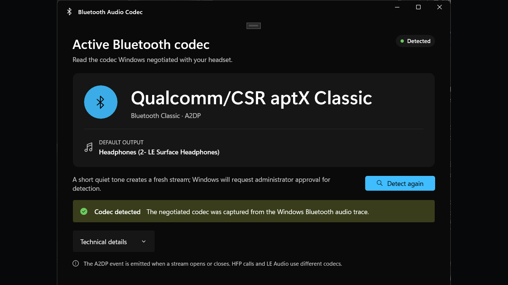
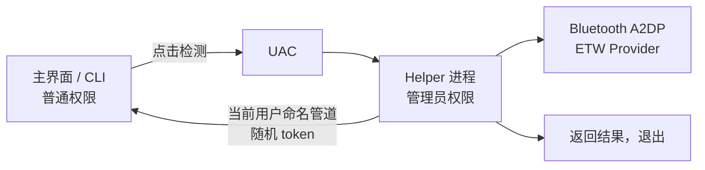

<div align="center">
  

# Bluetooth Audio Codec

查看 Windows 与蓝牙耳机当前协商使用的 A2DP 编解码器

SBC · AAC · aptX · aptX HD · aptX LL · LDAC · LHDC 等

Windows 10/11 · C++20 / WinUI 3 · x64 / ARM64
</div>



## 下载

### Microsoft Store（推荐）

<a href="https://get.microsoft.com/installer/download/9p8g2cqw77jt?referrer=appbadge" target="_self">
  
</a>

商店页面：<https://apps.microsoft.com/detail/9P8G2CQW77JT>

```powershell
winget install --source msstore --id 9P8G2CQW77JT
```

### 离线 MSI

从 [GitHub Releases](https://github.com/A-BenLi06/Bluetooth-Audio-Codec-Viewer-WinUI3/releases) 下载对应架构的 MSI 安装包（x64 或 ARM64）。安装包内置 WinUI 运行库，不需要 .NET Runtime。

## 这个工具做什么

Windows 不提供查看当前蓝牙音频编解码器的界面。耳机标称支持 LDAC 或 aptX，连上 Windows 后可能实际回退到 SBC，用户无从得知。

Bluetooth Audio Codec 订阅 Windows 的 Bluetooth A2DP ETW 事件，读取系统与蓝牙设备当前协商的编解码器、codec ID 和默认音频输出设备，直接呈现结果。检测在本机完成，不录音、不改设置、不装驱动、不联网。

## 功能

- 检测当前 A2DP 编解码器，识别 SBC、AAC、aptX (Classic/HD/LL)、FastStream、LDAC、LHDC、Samsung Scalable Codec 等；未知编码保留原始 ID
- 检测时暂停正在播放的系统媒体会话，播放测试音触发编解码器协商，完成后恢复暂停的会话
- 应用打开期间监听蓝牙音频设备连接/断开，刷新设备名和默认输出
- 显示标准 codec ID、vendor ID、vendor codec ID、默认输出设备和检测时间
- 本地轮转日志和统一的"报告问题"入口，可预览并导出脱敏诊断 ZIP，不自动上传
- 提供同一内核的 CLI 工具，支持 `--json` 输出和脚本集成
- 支持 x64 和 ARM64，内置九种语言
- C++20 / WinUI 3 原生构建，不依赖 .NET Runtime

## 使用

1. 连接蓝牙耳机并设为默认播放设备。
2. 打开应用，点击 **Detect codec**。
3. 在 UAC 提示中允许管理员权限。
4. 检测到编解码器后，结果显示在主卡片上。展开 **Technical details** 查看原始标识。

如果未捕获事件，可暂停其他播放后重试，或断开重连耳机后再检测。

## 工作原理



Windows 将蓝牙 A2DP 的 ETW 事件限制为仅提权进程可订阅。主界面始终以普通权限运行，仅在检测时启动短生命周期的 Helper 进程。Helper 通过当前用户命名管道（随机 256-bit token）回传结果后立即退出。

## CLI

CLI 与 UI 编译 `BluetoothAudioCodec.Core` 中同一份 C++20 源码，共享 ETW 解析、提权通信、媒体暂停/恢复、设备查询和诊断导出。

```powershell
./build-cli.ps1
./BluetoothAudioCodec.Cli/bin/x64/Release/BluetoothAudioCodec.Cli.exe --timeout 30 --json
./BluetoothAudioCodec.Cli/bin/x64/Release/BluetoothAudioCodec.Cli.exe --watch --no-tone
./BluetoothAudioCodec.Cli/bin/x64/Release/BluetoothAudioCodec.Cli.exe --export-report report.zip --include-runtime-log
```

CLI 从普通终端启动，检测时按需请求 UAC。`Ctrl+C` 取消检测并恢复暂停的媒体。完整参数和退出码见 [CLI 文档](BluetoothAudioCodec.Cli/README.md)。旧 C# CLI 已归档至 `archive/legacy-cli/`。

## 支持范围

- Windows 10 2004 (build 19041) 及以上，Windows 11
- x64、ARM64
- 仅 Bluetooth Classic A2DP 播放；HFP 通话 (CVSD/mSBC) 和 LE Audio (LC3) 不在检测范围内
- 部分第三方驱动不提供可解析的 A2DP ETW 事件，应用会报告原因，不会猜测编码

## 反馈问题

复现问题后，点击 **报告问题… / Report a problem…**，选择出错的检测记录，可选附加近期运行日志，预览后保存 `.zip`。报告包含构建 ID、Windows 和驱动版本、检测终态和设备关系，不含蓝牙地址、设备昵称、音频或完整 ETW 数据。在 GitHub Issues 附上 ZIP 提交即可。

诊断格式和接收校验见 [diagnostics/README.md](diagnostics/README.md)。

## 开发

在 VS 2022/2026 中打开 `BluetoothAudioCodec.slnx`，启动项目为 `BluetoothAudioCodec.WinUI`，选择 Debug / x64，按 F5 运行。Debug 配置为自包含 EXE，不需要部署 MSIX。

### 环境

- Visual Studio 2022 或 2026，C++ 桌面开发、WinUI C++ 工具、ARM64 交叉编译
- Windows 10 SDK 10.0.26100+
- WiX Toolset SDK 6（构建 MSI 安装包时需要，NuGet 还原 6.0.2）
- .NET SDK 仅用于 WiX 构建；CLI 和 UI 不需要 .NET

### 构建

```powershell
# Release 构建
msbuild .\BluetoothAudioCodec.WinUI\BluetoothAudioCodec.WinUI.vcxproj `
    /restore /p:Configuration=Release /p:Platform=x64

# MSI 安装包
.\build-store-installer.ps1 -Architecture all -Version 1.1.0

# CLI
.\build-cli.ps1
```

签名发布和 Store 提交流程见 [docs/STORE_SUBMISSION.md](docs/STORE_SUBMISSION.md)。架构和依赖规则见 [docs/ARCHITECTURE.md](docs/ARCHITECTURE.md)。

## 项目结构

| 路径 | 说明 |
| --- | --- |
| `BluetoothAudioCodec.slnx` | 统一解决方案 |
| `BluetoothAudioCodec.Core/` | 共享原生内核，不依赖 WinUI |
| `BluetoothAudioCodec.WinUI/` | WinUI 3 界面、本地化、MSIX 定义 |
| `BluetoothAudioCodec.Cli/` | CLI 入口和参数解析 |
| `BluetoothAudioCodec.Installer/` | WiX MSI 安装器 |
| `tests/` | 设备识别和连接状态测试 |
| `diagnostics/` | 诊断格式规范和校验工具 |
| `docs/` | 架构、迁移、审计等技术文档 |
| `StoreAssets/` | 商店图标、截图和文案 |
| `archive/legacy-cli/` | 已归档的旧 C# CLI |

## 隐私

- 所有检测和解析在本地完成，不联网，不上传遥测
- 不录制或保存音频
- 不修改蓝牙、音频或系统设置
- 不安装驱动、服务或常驻管理员进程
- 本地日志约 1 MiB 后轮转，可由用户主动导出

隐私政策见 [StoreAssets/PRIVACY_POLICY.md](StoreAssets/PRIVACY_POLICY.md)。

## 支持开发

- [Ko-fi](https://ko-fi.com/benli06)
- [爱发电](https://afdian.com/a/benli06)

## English overview

Bluetooth Audio Codec reports the active Bluetooth Classic A2DP codec negotiated by Windows. It subscribes to Windows A2DP ETW events to read the current codec, codec IDs, and default audio endpoint. Detection is fully local—no audio recording, no settings changes, no drivers, no network access.

Available on the [Microsoft Store](https://apps.microsoft.com/detail/9P8G2CQW77JT) and as offline MSI installers from [GitHub Releases](https://github.com/A-BenLi06/Bluetooth-Audio-Codec-Viewer-WinUI3/releases). Built with C++20 and WinUI 3, no .NET dependency. Supports x64 and ARM64, Windows 10 build 19041+.

## License

MIT License. See [LICENSE](LICENSE).

Bluetooth is a trademark of Bluetooth SIG, Inc. Other trademarks belong to their respective owners.
